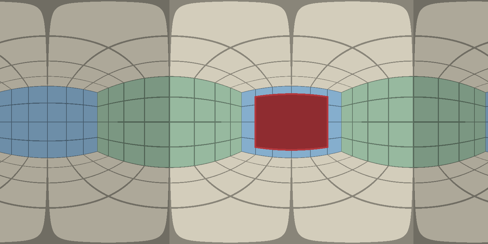
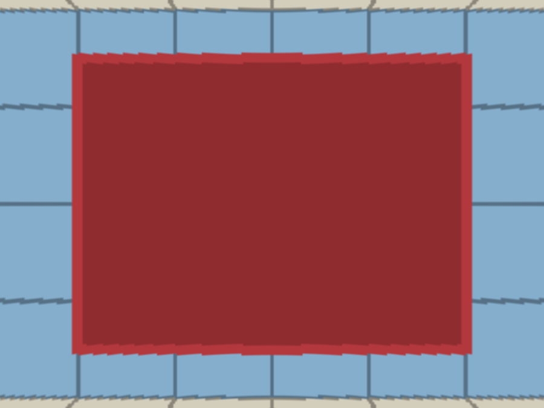

# pano-reframe

Turn a stitched spherical panorama into a regular camera view with deterministic
pixel reprojection. A Python CLI and reusable Codex skill for inspecting drone or
gimbal panoramas, especially architectural references.

Choose yaw, elevation, horizontal field of view, a calibrated compass heading, or
a wall-facing direction. Each output includes a JSON manifest recording its source
hash, orientation, projection assumptions and available coverage. Processing is
local; source images are preserved.

## Synthetic example

This deliberately simple, ray-cast room is rotated 35° relative to the panorama
centre. Its flat walls look curved in the equirectangular image:



Four marked corners of the red rectangular frame recover a wall-facing view:



The example contains no real-world photographs or private building geometry.
Corner coordinates and the command to reproduce the view are in
[examples/README.md](examples/README.md).

## Install

Requires Python 3.10 or newer, NumPy and Pillow.

```sh
git clone https://github.com/alistairreay/pano-reframe.git ~/development/pano-reframe
cd ~/development/pano-reframe
python3 -m venv .venv
.venv/bin/python -m pip install -e '.[test]'
.venv/bin/pano-reframe --help
```

To make it discoverable as a personal Codex skill, link the repository into the
skills directory. The command will fail if a skill already occupies that name;
inspect that existing installation before replacing anything.

```sh
mkdir -p ~/.codex/skills
ln -s ~/development/pano-reframe ~/.codex/skills/pano-reframe
```

Invoke `$pano-reframe` in Codex, or let Codex select it for a panorama task.
[SKILL.md](SKILL.md) contains the agent workflow; [AGENTS.md](AGENTS.md) describes
development conventions. The portable entrypoint also works from another directory:

```sh
~/development/pano-reframe/.venv/bin/python \
  ~/development/pano-reframe/scripts/pano_reframe.py --help
```

## Inspect and extract

```sh
.venv/bin/pano-reframe inspect /path/to/sphere.jpg
.venv/bin/pano-reframe view /path/to/sphere.jpg --full-sphere \
  --yaw 90 --elevation 10 --hfov 70 --width 1200 --height 900 \
  --output /path/to/east-view.png
```

Use `--full-sphere` only for a **known 360° × 180° equirectangular panorama**. A 2:1
aspect ratio alone does not establish its projection or coverage. Otherwise the
tool requires GPano spherical crop metadata, including full dimensions and offsets.
It handles uniform resizing of those coordinates and rejects incompatible crops,
nonuniform resizing and non-normalized EXIF orientation.

Yaw zero is the centre direction of the full spherical canvas after pitch/roll
leveling; positive yaw turns right. Pitch, also called elevation, looks above the
horizon when positive. Elevation here is an angle, not altitude. `--hfov` sets the
output's horizontal field of view; vertical FoV follows the image aspect ratio.
The default view is 1200 × 900, 70° horizontal FoV, at yaw/pitch/roll zero.

`--source-pitch` and `--source-roll` override calibration and GPano pose metadata.
Missing pose values default to zero. Level drone/gimbal capture is useful context;
verify the stitched horizon visually. Output `--roll` rotates the view independently.
Angles follow [GPano conventions](https://developers.google.com/streetview/spherical-metadata).

A point aim can also centre a feature, using coordinates in the **original source**:

```sh
.venv/bin/pano-reframe view /path/to/sphere.jpg --full-sphere \
  --point 4096 1800 --output /path/to/feature.png
```

That aims at the feature; it does not recover a perpendicular wall orientation.
Specify `--pitch` if you want to override the point's elevation.

## Compass headings

```sh
.venv/bin/pano-reframe view /path/to/sphere.jpg --full-sphere \
  --heading 180 --heading-zero 25 --output /path/to/south.png
```

`--heading-zero` is the compass bearing of relative yaw zero. The tool also accepts
`heading_zero` in a calibration profile or GPano `PoseHeadingDegrees`; it fails
clearly when no bearing reference exists. Calibrate from a known landmark using
`heading_zero = (known_bearing - relative_yaw) modulo 360`.

It does not infer stitched orientation from arbitrary DJI aircraft yaw, EXIF image
direction or preferred-view metadata. It does not query DJI Fly or flight logs.
Use a consistent true/magnetic north reference; no declination conversion is done.

## Face a wall

**From a floor plan:** supply a segment, camera position, and the panorama yaw of
plan north. Plan X points east and Y points north; use consistent length units.
`--north-yaw` is required, even when zero.

```sh
.venv/bin/pano-reframe wall /path/to/sphere.jpg --full-sphere \
  --segment 0 4 5 4 --camera 2 0 --north-yaw 30 \
  --name fireplace --save-wall /path/to/calibration.json \
  --output /path/to/fireplace.png
```

**From the image:** mark four original-resolution corners of a genuine rectangle
in a vertical wall, such as a window frame. Order: top-left, top-right, bottom-right,
bottom-left. The top/bottom must represent parallel horizontal edges.

```sh
.venv/bin/pano-reframe wall /path/to/sphere.jpg --full-sphere \
  --corners 3500 1700 4700 1700 4700 2400 3500 2400 \
  --name window-wall --save-wall /path/to/calibration.json \
  --output /path/to/window-wall.png
```

Those coordinates are illustrative; choose points from your own source, accounting
for resized previews. The helper estimates a horizontal vanishing direction and
checks whether the sides are consistent with vertical edges. Degenerate or
inconsistent annotations fail. A passing estimate still depends on the frame,
source pose and stitching; inspect the result. A projecting or angled fixture can
have a different normal from its surrounding wall.

Reuse saved wall calibration:

```sh
.venv/bin/pano-reframe view /path/to/sphere.jpg --full-sphere \
  --calibration /path/to/calibration.json --wall fireplace \
  --output /path/to/fireplace-again.png
```

Saved profiles are bound to the source's SHA-256 hash. To add another wall, pass
the same file to both `--calibration` and `--save-wall`, with deliberate `--overwrite`.
See [geometry and calibration](references/geometry.md) for the JSON schema and math.

## Boundaries

- Input must already be stitched and equirectangular. Cylindrical panoramas,
  ordinary wide-angle photographs and individual source-frame stitching are outside
  this tool's scope.
- Aperture and the DJI Flip's source-camera focal length do not need to be reapplied
  to an already stitched sphere. Extraction uses angular coverage and the chosen
  virtual-camera FoV. Source-frame calibration would matter when building a stitcher.
- Rotation preserves the original viewpoint. It cannot recover depth, physical
  measurements, missing detail, or fix stitching/parallax artifacts.
- GPano crops identify missing coverage: PNG outputs expose it as transparency;
  JPEG outputs use black. Filled/synthetic regions and pre-existing source alpha
  are not used as a validity mask. Bilinear interpolation does not create detail.
- Metadata inspection omits GPS coordinates. Standard GPano XMP is supported;
  split/extended XMP and arbitrary vendor MakerNotes are not reconstructed.
- Output dimensions are limited to 40 million pixels and horizontal FoV to
  `(0, 175)` degrees. Existing output files require `--overwrite`; the source itself
  cannot be overwritten.

## Tests

```sh
.venv/bin/python -m pytest
```

The suite enforces **100% statement and branch coverage** for the package and skill
wrapper, with no coverage exclusions. It checks geometric ground truth, yaw/pitch/
roll, FoV, seams, crop masks, pose correction, wall estimates, metadata parsing,
invalid inputs, calibration provenance, output protection and CLI entrypoints.
GitHub Actions runs the same checks on Python 3.10, 3.12 and 3.13.

All fixtures are synthetic and generated by tests. Keep personal panoramas and
derived local previews outside version control; `tmp/` is ignored for local work.

## License

[MIT](LICENSE).
